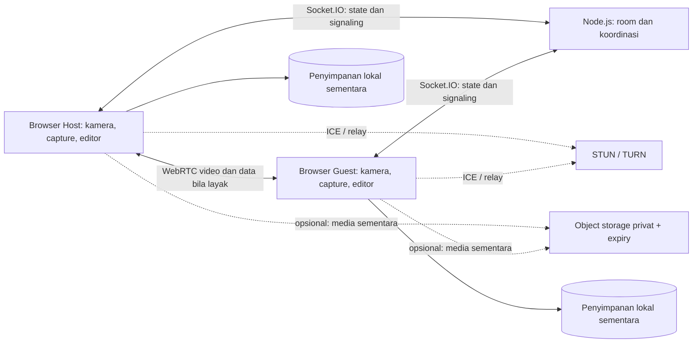

# Rancangan arsitektur teknis

Status: rekomendasi Tahap 3 untuk diimplementasikan setelah review dan spike. Tidak ada bukti build atau implementasi di paket ini. Prinsip: satu aplikasi web, satu backend realtime, dua peserta per room; hindari layanan tambahan yang belum diperlukan, namun jangan mengorbankan recovery yang sudah diminta.

## Keputusan stack yang diusulkan

| Komponen | Pilihan | Status / alasan |
|---|---|---|
| Frontend | React, TypeScript, Vite | Rekomendasi UI dan editor; tentukan versi setelah cek dokumentasi terkini. |
| Backend | Node.js, TypeScript, Socket.IO | Satu proses awal untuk signaling, otorisasi room, state dan koordinasi. |
| Kamera / media | getUserMedia + WebRTC | Video lokal/remote; HTTPS/secure context dan izin kamera. Audio tidak termasuk Flipbook MVP; kebutuhan suara Duo belum ditetapkan. |
| Konektivitas | STUN dan TURN | TURN penting untuk jaringan restriktif; dapat meneruskan video dan data. Kredensial berumur pendek, secret di server. |
| Editor | Canvas 2D + model dokumen | Bahan asli dan operasi edit terpisah; pilihan library editor belum dikunci. Kolaborasi dan undo personal perlu spike. |
| Room state | Memori satu proses | Cukup untuk rejoin selagi server hidup. Restart kehilangan sesi sesuai keputusan pengguna. |
| Media sementara | IndexedDB lokal + object storage privat sementara jika diperlukan | Bukan keputusan final: target refresh/tutup tab dan sinkronisasi lintas perangkat membuat memori saja tidak cukup. Spike DataChannel vs object storage; batasi TTL 1 jam dan cleanup. Jangan menjanjikan persistensi IndexedDB tanpa uji. |
| Database | Belum wajib | Tidak ada akun/riwayat dan sesi boleh hilang saat server restart. Object storage tidak memerlukan database semata-mata untuk MVP; pastikan TTL/otorisasi/cleanup benar-benar dapat dilaksanakan. |
| Export | Canvas PNG/JPG; encoder GIF; MediaRecorder atau encoder/konversi MP4 setelah spike | MP4 target MVP bukan bukti browser semua mendukung. Jangan pilih format alternatif sebagai pengganti MP4 tanpa keputusan pengguna. |



## Kamera, koneksi dan signaling

Browser meminta izin kamera, menangani penolakan/tidak ada perangkat, memulai preview lokal dan menghentikan track saat selesai. Browser bertukar SDP offer/answer dan ICE candidate melalui server signaling yang memvalidasi keanggotaan room. Host dapat memulai negosiasi agar sederhana; tangani reconnect, timeout, ICE failure dan renegosiasi. WebRTC tidak menjamin direct peer-to-peer: TURN adalah relay sehingga media dapat melintasi server.

Video remote yang tampil memiliki delay dan kompresi. Jangan screenshot remote video sebagai cara utama membuat pasangan Classic: kedua perangkat mengambil frame lokal di target waktu bersama dan menyinkronkan hasilnya. Mintalah persetujuan/izin sesuai UX; jangan akses kamera otomatis tanpa tindakan yang sesuai.

## Sinkronisasi dan ketahanan

Server otoritatif untuk role, membership, fase, kesiapan, nomor versi dan target capture. Client mengestimasi offset clock menggunakan beberapa pertukaran, server mengirim jadwal masa depan; waktu dan kesiapan diberi ID. Dua perangkat menangkap lokal dan melaporkan hasil. Jam yang disinkronkan tidak menyinkronkan sensor secara sempurna; ukur ketidakpastian dan kegagalan. Timer background atau layar terkunci tidak dapat diasumsikan presisi.

Socket.IO membawa peristiwa kecil; video melalui WebRTC. Media besar tidak dikirim sembarangan via event tanpa batas. DataChannel yang diuji perlu chunking, backpressure, verifikasi kelengkapan dan batas ukuran; jika tidak mencukupi, gunakan private object storage dengan akses dan expiry terikat sesi. Gagal/timeout transfer sesuai keputusan pengguna: ulang pasangan capture, tidak mengorbankan hasil valid sebelumnya.

Editor menggunakan dokumen bersama berversi, perubahan tervalidasi dan snapshot untuk reconnect/ekspor. User menginginkan interaksi serentak tanpa lock yang terlihat dan undo personal: ini bukan otomatis tercapai dengan broadcast event. Spike harus membuktikan konflik edit objek yang sama, hapus vs edit, urutan event, idempotensi, dan personal undo tanpa membatalkan perubahan lain. Bila sulit, evaluasi pustaka kolaborasi yang sesuai setelah Context7; jangan diam-diam mengganti UX dengan lock.

## Storage dan keamanan dasar

Gunakan invite code acak dan token rejoin berbeda untuk setiap peserta; kode saja tidak membuktikan identitas. Validasi peran, membership, state, ukuran dan frekuensi pesan di server. Batasi dua peserta, tebakan kode dan upload; gunakan HTTPS/WSS. Jangan taruh TURN secret di frontend. Data lokal dan objek sementara perlu kebijakan pembersihan yang diuji; local storage/IndexedDB tidak kebal dihapus browser dan tidak menghapus salinan perangkat lain. Hindari mencatat media atau payload editor di log.

Sebelum memakai object storage, putuskan detail batas 1 jam, cara otorisasi akses, penghapusan terjadwal termasuk crash, dan bagaimana hasil pribadi dapat diakses setelah room ditutup. Tidak menjamin penghapusan semua replika/backups tanpa menguji dan memeriksa penyedia.

## Schema database jika kelak perlu

Tidak diimplementasikan sekarang. Jika kebutuhan berubah ke akun, riwayat atau pemulihan setelah restart, PostgreSQL dapat menyimpan `rooms(id,status,created_at,expires_at)`, `participants(id,room_id,role,...)`, `sessions(id,room_id,mode,status,...)`, `media_assets(id,session_id,storage_key,expires_at,...)`. Tambahkan akses dan retensi sesuai kebutuhan; jangan simpan foto di tabel hanya karena schema ini tersedia. Redis/shared state dipertimbangkan saat multi-instance, bukan asumsi awal.

## Struktur usulan

```text
web-aselole/
  apps/web/src/{app,features/{room,camera,classic,flipbook,editor,export},components,lib}/
  apps/server/src/{rooms,signaling,realtime}/
  packages/shared/src/{events,room,validation}/
  docs/  README.md  package.json  .env.example
```

Monorepo satu Git repository; struktur dapat disesuaikan dengan source nyata. Jangan mengira folder ini sudah ada. Shared types tidak menggantikan validasi runtime di server.

## Lingkungan, Git, deployment

- Pilih Node LTS dan satu package manager, catat versi dan lockfile; jangan mengarang versi tanpa memeriksa dukungan aktual. `.env.example` hanya nama variabel seperti `PORT`, `WEB_ORIGIN`, URL server/STUN/TURN dan secret TURN server-side. Nilai dan cara memperoleh kredensial sementara disepakati saat implementasi.
- HTTPS untuk staging dan akses kamera di perangkat lain; localhost hanya merujuk ke perangkat itu sendiri. Uji dua perangkat dan jaringan berbeda termasuk jaringan relay-only.
- Git: satu repo, `main` stabil, branch fitur pendek, PR, CI install/lint/typecheck/test/build. Abaikan secret, hasil media, dan build. Jangan inisialisasi repo di lokasi yang salah atau menganggap root workspace ini source app.
- Hosting frontend statis HTTPS, satu Node server yang mendukung koneksi Socket.IO tahan lama, dan TURN terkelola atau mandiri. Periksa proxy timeouts, origin, biaya relay dan deployment. Restart mengakhiri sesi; deployment bertahap/multiple instance belum diperlukan.

Rujukan: [getUserMedia](https://developer.mozilla.org/en-US/docs/Web/API/MediaDevices/getUserMedia), [WebRTC peer connections](https://webrtc.org/getting-started/peer-connections), [TURN](https://webrtc.org/getting-started/turn-server), [MediaRecorder support](https://developer.mozilla.org/en-US/docs/Web/API/MediaRecorder/isTypeSupported_static), [Socket.IO rooms](https://socket.io/docs/v4/rooms/). Periksa dokumentasi mutakhir dan Context7 saat implementasi.
